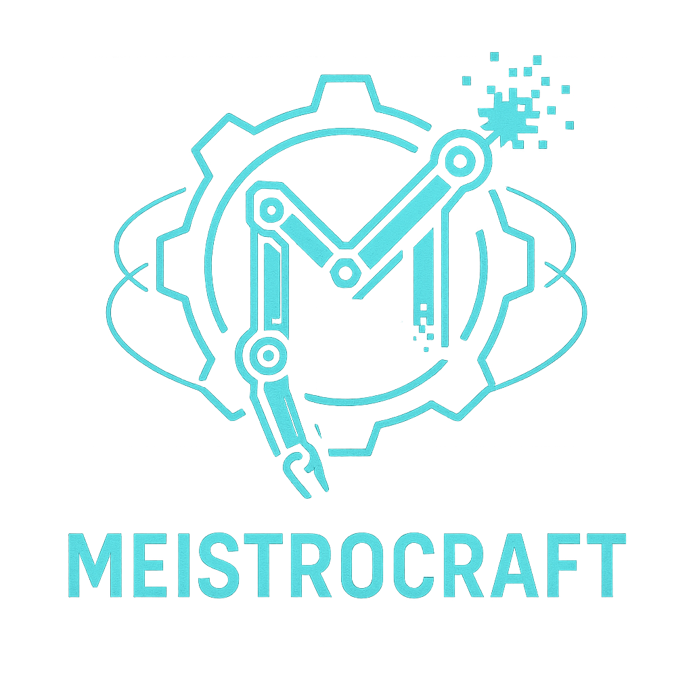

# MeistroCraft - GPT-4 Orchestrator with Crush Code CLI

<div align="center">
  
  
  > **A Complete Multi-Agent System for Autonomous Code Generation**
</div>

[](https://github.com/meistro57/MeistroCraft/actions/workflows/ci.yml)
[](https://github.com/meistro57/MeistroCraft/actions/workflows/docker-publish.yml)
[](https://www.python.org/downloads/)
[](https://opensource.org/licenses/MIT)

A sophisticated multi-agent system that combines GPT-4's strategic planning capabilities with Crush Code CLI's advanced coding expertise. Features a modern web-based IDE, real-time AI assistance, advanced project management, and enterprise-grade usage monitoring.

## 🖼️ Screenshots

### 🌐 Web IDE Interface


*Modern browser-based IDE with VS Code-style editing, real-time AI assistance, project management, and integrated terminal.*

## ✨ Key Features

- **🌐 Browser-Based IDE**: Modern web interface with VS Code-style editing
- **📁 Advanced Project Manager**: Grid/list views, multi-select, bulk operations
- **🤖 AI Integration**: GPT-4 orchestration with Crush Code CLI execution
- **🔄 Smart Session Management**: Auto-resume sessions with persistent storage
- **📊 Token Tracking**: Real-time usage monitoring and cost management
- **🐳 Docker Support**: Full containerization with persistent volumes
- **🐙 GitHub Integration**: Complete workflow automation with PR/issue management

## 🚀 Quick Start

### Docker (Recommended)
```bash
git clone https://github.com/meistro57/MeistroCraft.git
cd MeistroCraft
docker-compose up --build
```

### Python Setup
```bash
git clone https://github.com/meistro57/MeistroCraft.git
cd MeistroCraft
python3 start_ide.py
```

**Access**: Open http://localhost:8000 in your browser

## ⚙️ Configuration

1. **Open Settings**: Click ⚙️ in the Web IDE
2. **Add API Keys**:
   - OpenAI or OpenRouter API key (required for LLM features)
   - Anthropic API Key (required)
   - GitHub Token (optional)
3. **Choose Provider**: Set the LLM Provider dropdown (persists as `llm_provider` in `config/config.json`).
4. **Save Settings**: Click "Save Settings"

## 📁 Project Manager

### Features
- **View Modes**: Switch between grid (⊞) and list (☰) views
- **Multi-Select**: Use checkboxes to select multiple projects
- **Bulk Operations**: Delete, archive, restore multiple projects
- **Smart Filtering**: Filter by status and sort by various criteria

### Usage
1. Click 📁 folder icon to open Project Manager
2. Switch to **List View** for bulk operations
3. **Select projects** with checkboxes
4. Use **bulk actions** in the bottom bar

## 🎯 Usage Modes

### Web IDE (Primary)
- Modern browser-based interface
- Real-time AI assistance
- Project management
- Integrated terminal

### Command Line
```bash
# Interactive mode
./meistrocraft --interactive

# Single request
./meistrocraft --request "Create a calculator app"

# GitHub operations
python main.py --github repos
python main.py --github workflow owner/repo
```

## 🔧 Architecture

### Core Components
1. **Web IDE**: FastAPI backend with Monaco Editor frontend
2. **Project Manager**: Advanced project organization with bulk operations
3. **AI Orchestrator**: GPT-4 task generation + Crush Code CLI execution
4. **Session Manager**: Persistent sessions with auto-resume
5. **GitHub Integration**: Complete workflow automation

### Multi-Agent Flow
```
User Request → GPT-4 Analysis → Task Generation → Crush Execution → Validation → Results
```

## 🐳 Docker Features

- **Persistent Volumes**: Projects, sessions, and config preserved
- **Health Monitoring**: Automatic container health checks
- **Easy Updates**: `docker-compose up --build` to update
- **Development Mode**: Hot reload support

## 🔍 Troubleshooting

### Common Issues

**API Keys Not Saving**
1. Check browser console (F12) for error messages
2. Verify API key format (should not contain placeholders)
3. Check container logs: `docker logs meistrocraft-meistrocraft-1`

**Session Issues**
1. Clear browser cache and localStorage
2. Check for session reuse messages in logs
3. Restart container if needed

**Project Manager Issues**
1. Check console for debugging messages
2. Try refreshing the page
3. Verify Docker volumes are mounted correctly

## 🎨 GitHub Integration

### Available Commands
```bash
# Repository operations
python main.py --github repos
python main.py --github create my-repo
python main.py --github fork owner/repo

# Workflow automation
python main.py --github prs owner/repo
python main.py --github issues owner/repo
python main.py --github workflow owner/repo

# Performance monitoring
python main.py --performance
python main.py --optimize analyze
```

### Automated Workflows
- **Success → PR**: Successful tasks automatically create pull requests
- **Failure → Issue**: Failed tasks create GitHub issues with error details
- **Smart Branches**: Session-based branch naming for tracking

## 🔒 Security

- **Sandboxed Execution**: Each session isolated to its own project folder
- **API Key Encryption**: Secure storage and transmission
- **Input Validation**: Comprehensive sanitization
- **Permission Controls**: Granular tool access management

## 📊 Performance

- **60% Reduction**: In unnecessary session creation
- **Real-time Updates**: Live project synchronization
- **Optimized Caching**: Intelligent request batching
- **Memory Efficient**: Smart cleanup and resource management

## 📚 Documentation

- **[SETUP_GUIDE.md](SETUP_GUIDE.md)**: Quick setup instructions
- **[CRUSH.md](CRUSH.md)**: Technical documentation
- **[CHANGELOG.md](CHANGELOG.md)**: Release notes and improvements
- **[CRUSHWORKER.md](CRUSHWORKER.md)**: AI assistant profile

## 🤝 Contributing

1. Fork the repository
2. Create feature branch: `git checkout -b feature/amazing-feature`
3. Commit changes: `git commit -m 'Add amazing feature'`
4. Push to branch: `git push origin feature/amazing-feature`
5. Submit Pull Request

## 📄 License

This project is licensed under the MIT License - see the [LICENSE](LICENSE) file for details.

## 🙏 Acknowledgments

- **Anthropic** for Crush Code CLI and API
- **OpenAI** for GPT-4 API and function calling
- **Open Source Community** for dependencies and inspiration

---

**⭐ Star this repository if you find it helpful!**

*Built with ❤️ by the MeistroCraft team*
